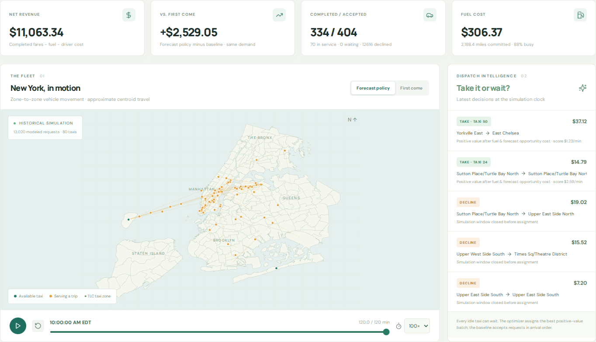
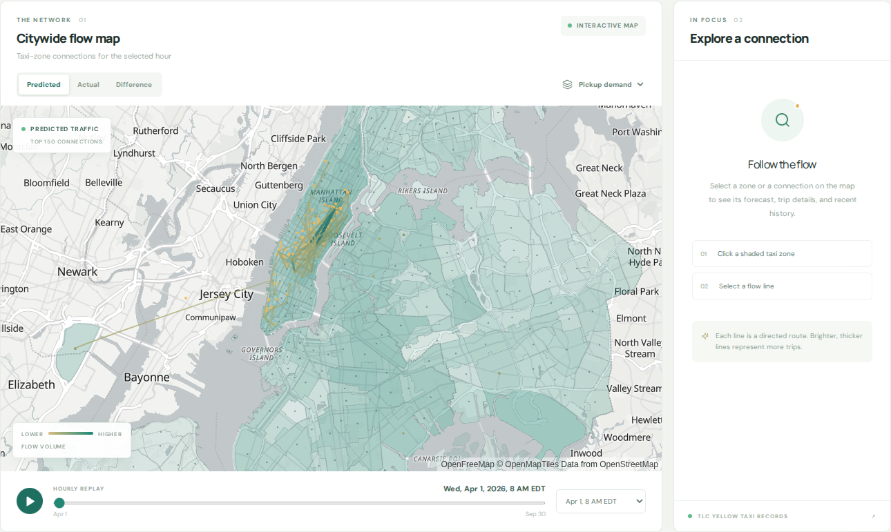
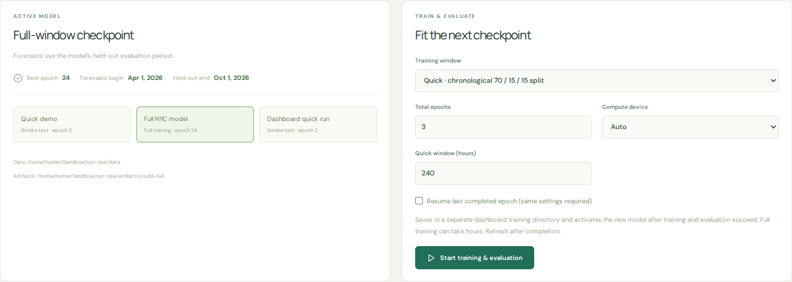
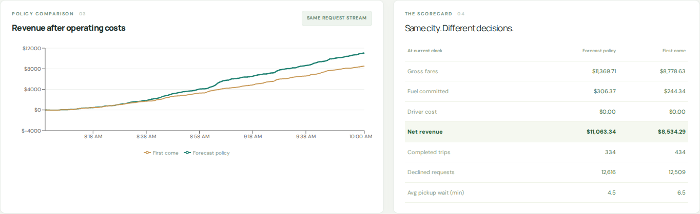

# Motion / NYC

**Forecast taxi demand. Dispatch a limited fleet. Compare the revenue.**

A local NYC taxi operations lab built with PyTorch, SimPy, FastAPI, and React.
Explore historical trips, train a temporal graph network, and compare
forecast-guided dispatch with first-come service at up to **100× playback**.

[Quick start](#quick-start) · [Dashboard](#dashboard) · [How it works](#how-it-works) · [Example results](#example-results) · [Documentation](#documentation)



> Uses historical NYC TLC records. This is a research simulator, not live traffic
> or a production dispatch service.

## Quick start

**You need:** Python 3.12, Node.js 20+, npm, and Git LFS. CPU inference is
supported; CUDA is optional for training.

### 1. Clone the project and data

```bash
git lfs install
git clone git@github.com:homerquan/nyc-taxi-operator.git
cd nyc-taxi-operator
git lfs pull
```

The repository includes full and quick datasets, trained checkpoints, and
held-out evaluation results. LFS downloads total about **4.8 GB**; leave
additional space for the checkout and dependencies.

### 2. Install and launch

```bash
python3.12 -m venv .venv
source .venv/bin/activate
python -m pip install -e '.[test]'

npm --prefix frontend ci
npm --prefix frontend run build
python scripts/serve.py
```

Open **[localhost:8000](http://localhost:8000)**. The full checkpoint is selected
when available. The first full-history replay can take several minutes;
subsequent forecasts reuse the cache.

For a smaller, faster smoke test, start `python scripts/serve.py --demo` instead.
To clone source without downloading data, prefix the clone command with
`GIT_LFS_SKIP_SMUDGE=1` and fetch the data later with `git lfs pull`.

## Dashboard

| Workspace | What you can do |
| --- | --- |
| **Fleet simulation** | Set fleet size, fuel price, MPG, fare multiplier, and demand; compare dispatch policies |
| **Demand forecast** | Explore predicted, observed, and error flows between NYC taxi zones |
| **Model & training** | Select a checkpoint, train on CPU/CUDA, resume a run, and inspect losses and logs |

**Try a scenario:** choose a historical start and a 1–6 hour window, then click
**Run comparison**. Play, pause, scrub the timeline, or select **1× to 100×**.
The map shows available taxis, vehicles serving trips, and dispatch decisions.

| Demand forecast | Model & training |
| --- | --- |
|  |  |

Click a screenshot to open it at full size.

## How it works

1. **Prepare history.** TLC trips become hourly route counts, trip attributes,
   and completed-trip observations between NYC taxi zones.
2. **Predict demand.** A temporal graph network estimates next-hour route
   volumes, durations, metered fares, and departure-time distributions.
3. **Replay requests.** SimPy samples arrival times within historical
   quarter-hour bins. A seed makes the scenario reproducible.
4. **Dispatch and compare.** Both policies see the same requests and start with
   the same fleet locations. The UI compares fares, fuel, waits, and net revenue.

| Policy | Dispatch rule |
| --- | --- |
| **First come** | Process requests in arrival order and assign the nearest taxi that can meet the pickup deadline |
| **Forecast policy** | Every 30 seconds, match taxis to requests using estimated net earnings per occupied minute, forecast zone value, and the option to wait |

The forecast policy combines TGN predictions with a completed-trip duration
prior available before the scenario starts. Its forecast stays fixed during
the run. Both fleets start in forecast-informed locations, so this comparison
measures the additional dispatch policy rather than isolating prediction alone.

**Net revenue = completed metered fares − committed fuel cost − configured driver cost.**

Fuel includes empty pickup miles and is charged at dispatch; fares are booked
on completion. Trips still in service at the end are shown separately.
Insurance, maintenance, tolls, taxes, and other costs are excluded.

## Example results



Two seeded scenarios on **April 1, 2026**, each with **80 taxis for two hours**:

| Start time (New York) | First-come net revenue | Forecast-policy net revenue | Difference |
| --- | ---: | ---: | ---: |
| Midnight | $6,759.28 | $6,770.03 | +0.2% |
| 8 a.m. | $8,534.29 | $11,063.34 | +29.6% |

These runs use seed 42, $3.50/gallon fuel, 25 MPG, the default demand/fare/pickup
settings, and zero driver cost. [Saved results](artifacts/verification/simulation_benchmarks.json)
include the full assumptions and operational totals.

**Gains depend on the scenario.** This is a forecast-guided heuristic, not a
guarantee of higher revenue or a globally optimal shift plan. Similar revenue
can also hide different trip counts and average fares.

## Training and data

You can use the shipped model immediately or start a new run in **Model & training**.
Fresh dashboard runs save to separate directories and activate only after
training and held-out evaluation succeed. Resume continues the last matching run.

| Split | Period |
| --- | --- |
| Training | October 2023–September 2025 |
| Validation | October 2025–March 2026 |
| Test | April–September 2026 |

Requests are modeled from recorded **completed trips**; canceled, declined, and
unrecorded demand is absent. Durations, distances, and fares use historical
aggregate means. Vehicle motion follows approximate zone centroids, and fare
multipliers do not model demand elasticity. Full and quick checkpoints serve
different purposes; a smoke run establishes functionality, not model quality.

## Documentation

| Guide | Contents |
| --- | --- |
| [Training](docs/training.md) | CUDA/GB10 setup, quick and full runs, checkpoints, and resume |
| [Data & model](docs/data-and-model.md) | Downloading, preprocessing, time boundaries, architecture, and evaluation |
| [Development & API](docs/development.md) | Local dev servers, API/jobs, troubleshooting, deployment, and tests |
| [GPU training package](gpu_training_package/README.md) | Docker-based training, bundled inputs, and verifier |

```bash
python -m pytest -q
npm --prefix frontend test
npm --prefix frontend run build
```

The API and job queue are designed for one local server process and have no
authentication. Read the [deployment guidance](docs/development.md#api-and-deployment)
before exposing the app to a network.

Data source: [NYC Taxi & Limousine Commission](https://www.nyc.gov/site/tlc/about/tlc-trip-record-data.page).
