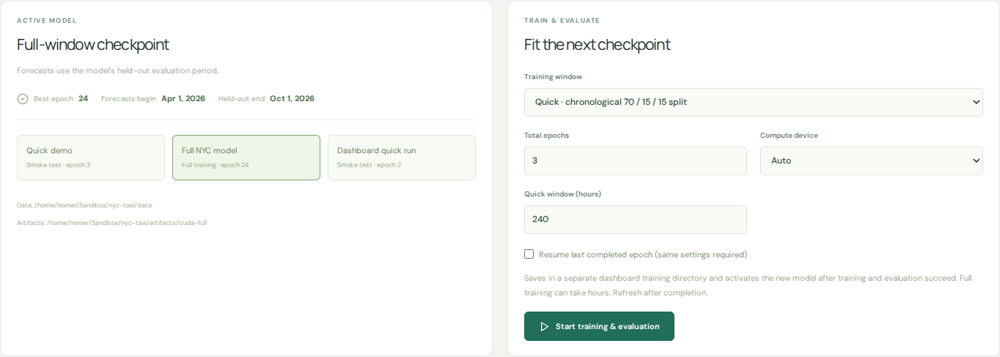

# Training guide

[← Project overview](../README.md) · [Data & model](data-and-model.md) · [Development](development.md)

Run the commands below from the repository root. The bundled checkpoints let
you use the dashboard immediately; retraining is optional.

## Train from the dashboard

Open **Model & training**, choose a quick or full window and a compute device,
then click **Start training & evaluation**. Fresh runs go into separate
subdirectories of `artifacts/dashboard-quick/` or `artifacts/dashboard-full/`.
The existing model remains active until both training and evaluation succeed.
Refresh the dashboard after completion.

To resume, select **Resume last completed epoch**, keep the same dataset and
settings, and specify the total desired epoch count. An interrupted partial
epoch is replayed from the last completed checkpoint.



## Requirements

- Python 3.12, Node.js 20 or later, and npm.
- Several GB of disk for the raw 36-month download, more for intermediate Parquet files, evaluation exports, packages, and DuckDB temporary storage. Full training is compute-intensive; CUDA is supported, as is CPU. MPS can be selected where the installed PyTorch/PyG operations support it.
- Internet access to download TLC data and, in the browser, the keyless OpenFreeMap basemap and fonts.

From the repository root:

```bash
python3.12 -m venv .venv
source .venv/bin/activate
pip install -e '.[test]'
cd frontend && npm install && cd ..
```

For a machine with an existing compatible PyTorch installation, install the appropriate CPU, CUDA, or MPS build first following the [PyTorch installation instructions](https://pytorch.org/get-started/locally/). No paid map token is needed.

### NVIDIA DGX Spark / GB10

The GB10 is an ARM64 CUDA GPU. A CPU-only PyTorch wheel will make `--device auto` choose the CPU even when `nvidia-smi` sees the GPU. After the setup above, install a CUDA-enabled PyTorch build into the project virtual environment. For this Spark's CUDA 13 driver and Python 3.12, the following official wheel was verified:

```bash
python -m pip install --index-url https://download.pytorch.org/whl/cu130 'torch==2.14.1+cu130'
python -c 'import torch; print(torch.__version__, torch.version.cuda, torch.cuda.is_available(), torch.cuda.get_device_name(0))'
```

Run an isolated GPU smoke train and evaluation without replacing an existing demo model:

```bash
python -m mobility.training --data-dir data/quick --artifacts-dir artifacts/manual-smoke --quick --max-hours 240 --max-positives 256 --epochs 3 --device cuda
python -m mobility.evaluation --data-dir data/quick --artifacts-dir artifacts/manual-smoke --device cuda
```

For the full processed window:

```bash
python -m mobility.training --data-dir data --artifacts-dir artifacts/manual-full --config configs/full.json --epochs 10 --patience 3 --device cuda
python -m mobility.evaluation --data-dir data --artifacts-dir artifacts/manual-full --device cuda
```

`--device cuda` fails with a clear error if CUDA is unavailable; `--device auto` prefers CUDA, then MPS, then CPU. Training prints the GPU name, compute capability, PyTorch and CUDA versions and records them in each checkpoint. It writes `progress.json` during each epoch and keeps both the best model and an epoch-boundary optimizer checkpoint. If interrupted, resume from the last completed epoch with the **same dataset and configuration**, and use the total desired epoch count:

```bash
python -m mobility.training --data-dir data --artifacts-dir artifacts/manual-full --config configs/full.json --epochs 10 --patience 3 --device cuda --resume artifacts/manual-full/training_state.pt
```

Use `--log-every-hours 24` for more frequent progress updates, or `0` to disable periodic reports. Evaluation also records its replay progress in `evaluation_progress.json`. A partially completed epoch is replayed after an interruption. CUDA kernels may produce slightly different floating-point results across runs or devices even with the same seed. The trained CUDA checkpoint can also be loaded on CPU for API serving; to serve it, set `NYC_ARTIFACTS_DIR=artifacts/manual-full` alongside `NYC_DATA_DIR=data`.


## Quick, reproducible real-data run

This uses January 2025 and the first ten days, with a chronological 70/15/15 split. It has deliberately few training epochs and should only be used as a smoke test.

```bash
python -m mobility.download --months 2025-01 --data-dir data/quick
python -m mobility.preprocess --months 2025-01 --data-dir data/quick
python -m mobility.training --data-dir data/quick --artifacts-dir artifacts/quick-retrain --quick --max-hours 240 --max-positives 256 --epochs 3 --device cpu
python -m mobility.evaluation --data-dir data/quick --artifacts-dir artifacts/quick-retrain --max-positives 256 --negatives 20 --device cpu
```

In one terminal, serve the API and its checkpoint:

```bash
NYC_DATA_DIR=data/quick NYC_ARTIFACTS_DIR=artifacts/quick-retrain uvicorn backend.app.main:app --host 127.0.0.1 --port 8000
```

In another terminal, start the dashboard:

```bash
cd frontend
npm run dev
```

Open `http://localhost:5173`. The development server proxies `/api` to port 8000. Inference reconstructs temporal memory from the saved data; the first request for a selected hour can take time, especially with a full dataset. The four most recent forecasts and the current chronological replay state are cached in the API process.

`--dev` downloads the most recently published month instead; `--months 2025-01 2025-02 2025-03` selects up to three months for development. `--quick` without `--max-hours` uses the entire processed period with 70/15/15 chronological splits. The full and quick datasets/checkpoints can be kept separate with `--data-dir` and `--artifacts-dir`; set `NYC_DATA_DIR` and `NYC_ARTIFACTS_DIR` to the same locations when serving.


## Containerized GPU training

The [GPU training package](../gpu_training_package/README.md) includes a Docker
Compose setup, the 36-month processed input bundle, and a separate verifier.
Its commands and artifacts are independent of the dashboard training jobs.
